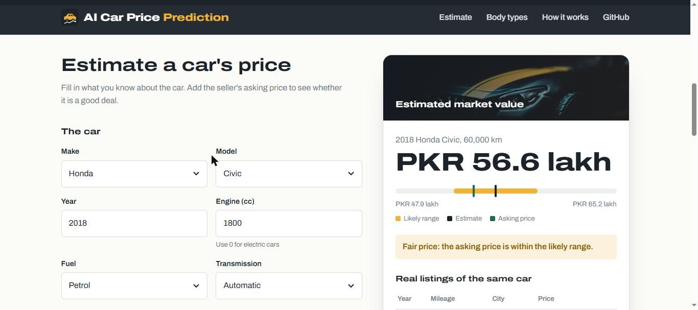
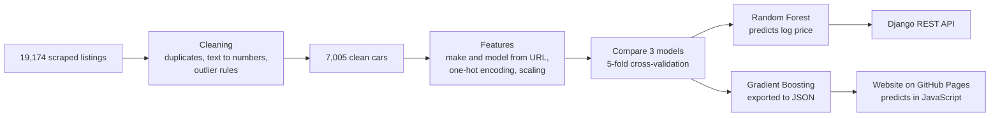

<p align="center">
  
</p>

<h1 align="center">AI Car Price Prediction</h1>

<p align="center"><strong>Intelligent Car Valuation Powered by Machine Learning</strong></p>

<p align="center">
  <a href="https://github.com/devshayanai-code/pak-wheels-price-predictor/actions/workflows/tests.yml"></a>
</p>

<p align="center"><strong>Live demo:</strong> <a href="https://devshayanai-code.github.io/pak-wheels-price-predictor/">devshayanai-code.github.io/pak-wheels-price-predictor</a><br>
<em>The model runs in your browser, so answers are instant.</em></p>


## Overview

AI Car Price Prediction estimates the fair market value of a used car in Pakistan. Enter the make, model, year, mileage, engine, fuel, transmission and city, and a machine learning model built from 7,005 cleaned PakWheels.com used-car listings (5,604 to train, 1,401 held back to test) returns a price estimate with the context needed to judge a deal.

## Problem statement

Used-car prices in Pakistan vary widely for the same make and model, and buyers and sellers usually rely on guesswork or a handful of listings. This project turns thousands of real listings into a model that gives an objective, data-based estimate, shows how uncertain it is, and compares it with real cars of the same type.

## Features

- **Estimated price** in lakh or crore.
- **Likely price range** based on the model's measured error on unseen cars.
- **Deal verdict** (good deal, fair price, or overpriced) if you enter the seller's asking price.
- **Real listings of the same car** to compare against.
- **One-click examples** for an SUV, a sedan, a hatchback and a sports car.
- **Input validation:** the model must belong to the make, and engine size is required for non-electric cars.
- **Two ways to use it:** a static website that runs the model in the browser, and a Django REST API.



## Results

Three regression models were compared with 5-fold cross-validation on the training set; the winner was then scored once on a held-out test set of cars it never saw.

| Model | CV average % error | CV average error (PKR) | CV R² |
| --- | --- | --- | --- |
| **Random Forest** (chosen) | **15.95%** | 914,793 | 0.845 |
| Gradient Boosting | 16.19% | 934,644 | 0.859 |
| Ridge regression (baseline) | 17.85% | 1,100,280 | 0.792 |

**Held-out test set:** 15.3% average error (MAPE), PKR 821,847 mean absolute error, R² 0.715. R² is lower on the test set because of one car: a PKR 20 crore Range Rover Vogue accounts for 86% of the squared error, and R² is 0.941 without it. That sensitivity to a single expensive car is why average percentage error is the headline metric.

## How it works



1. **Cleaning** (`src/data_cleaning.py`): one row per listing (the raw data repeated each car under several categories), prices like `PKR 3,650,000` and mileages like `138,000 km` converted to numbers, make and model extracted from each listing's URL, rare cities grouped as "Other", and typos or impossible values removed with documented rules (price under PKR 1 lakh, mileage over 500,000 km, engines over 7,000 cc, cars older than 1980).
2. **Exploration** (`src/eda.py`): price is heavily right-skewed, so the model learns `log(price)` and answers in rupees. Year (+0.55), engine size (+0.45) and mileage (−0.26) correlate with log price as expected. Charts are in `reports/figures/`.
3. **Training** (`src/train.py`): one scikit-learn pipeline holds the preprocessing and the model, so the API can never skip a step. Unseen car models at prediction time are handled instead of crashing.
4. **Browser model** (`src/export_web.py`, `docs/predictor.js`): the gradient boosting pipeline is exported to `docs/model.json`, and JavaScript repeats its steps (one-hot encoding, scaling, adding up 500 trees, undoing the log). A test checks it gives exactly the same prices as Python.
5. **Serving** (`api/`): Django REST Framework validates every input (case-insensitive makes, the model must belong to the make, engine size required for non-electric cars), loads the model once, and returns the estimate with its range and comparable listings.

## Technologies used

- **Machine learning:** Python 3.12, scikit-learn, pandas, NumPy, joblib
- **Charts:** Matplotlib, Seaborn (exploration only)
- **Backend:** Django 5.2, Django REST Framework, gunicorn
- **Frontend:** HTML, CSS, JavaScript
- **Testing and CI:** pytest, GitHub Actions
- **Hosting:** GitHub Pages (website), Render blueprint (API)

## API

| Endpoint | Method | Returns |
| --- | --- | --- |
| `/api/health/` | GET | Service status and model name |
| `/api/options/` | GET | Valid makes with their models, fuels, transmissions, cities, year range |
| `/api/predict/` | POST | Estimate, likely range, average error, similar listings |

```bash
curl -X POST http://127.0.0.1:8000/api/predict/ \
  -H "Content-Type: application/json" \
  -d '{"make":"Toyota","model":"Corolla","year":2016,"mileage":95000,"engine_cc":1300,"fuel":"Petrol","transmission":"Manual","city":"Karachi"}'
```

```json
{
  "predicted_price": 3460000,
  "price_range": {"low": 2930000, "high": 3990000},
  "average_error_percent": 15.3,
  "similar_listings": [
    {"year": 2016, "mileage": 95000, "city": "Karachi", "price": 3050000},
    {"year": 2016, "mileage": 104000, "city": "Islamabad", "price": 4125000},
    {"year": 2016, "mileage": 109478, "city": "Lahore", "price": 4190000}
  ]
}
```

Predictions are limited to 60 per minute per visitor.

## Project structure

```
src/             data cleaning, EDA and training code
api/             Django project: REST API + the web page
docs/            static website for GitHub Pages (model runs in JavaScript)
docs/assets/     logo and screenshots
tests/           pytest tests (cleaning steps, API, and JS matches Python)
data/raw/        original dataset (never edited)
data/processed/  cleaned dataset
reports/         charts and model scores (metrics.json)
models/          trained model (rebuilt, not stored in git)
render.yaml      Render deployment blueprint
```

## Installation

```bash
python -m venv venv
venv\Scripts\activate            # Windows (macOS/Linux: source venv/bin/activate)
pip install -r requirements-dev.txt
python -m src.data_cleaning      # raw CSV -> data/processed/
python -m src.train              # trains, compares and saves the model
python -m src.export_web         # exports the browser model to docs/
python -m pytest -q              # runs all tests
cd api && python manage.py runserver
```

Then open http://127.0.0.1:8000/.

## Deployment

**Live site:** https://devshayanai-code.github.io/pak-wheels-price-predictor/ (GitHub Pages, free). GitHub Pages only serves files, so `python -m src.export_web` trains the gradient boosting model (15.3% average error, close to the random forest's, at a fraction of the size) and writes it to `docs/model.json` with the dropdown options and listings. `docs/predictor.js` repeats the pipeline's maths in JavaScript: one-hot encoding, scaling, walking all 500 trees, then undoing the log. A test checks that it gives exactly the same prices as Python. After retraining, run the export again and push.

**API (optional):** `render.yaml` deploys the Django REST API to Render: it installs the requirements, cleans the data and trains the model during the build, then serves it with gunicorn. GitHub Actions runs the build, the export and all tests on every push.

## Limitations

- Prices are asking prices from listings, not final sale prices.
- The data is a snapshot; prices drift with inflation and the rupee, so the model needs retraining on fresh data to stay current.
- Condition, colour, accident history and trim level are not in the data, which explains part of the error.

## Data and credits

- Data: **PakWheels Used Car Listings**, a scraped dataset of used-car ads from [PakWheels.com](https://www.pakwheels.com), Pakistan's largest car marketplace. 19,174 rows (7,314 unique ads, because each ad appeared under several site categories), model years 1960 to 2025, 193 cities. Columns: category, title, price, city, year, mileage, fuel, engine, transmission, url (every url is the original PakWheels listing). The page it was downloaded from and its licence were not recorded; it is included here for educational, non-commercial use, and listings belong to their original posters.
- Photos on the website: [Unsplash](https://unsplash.com). Logo: original artwork made for this project (`docs/assets/logo.svg`).

## Author

**Shayan Ali Shah**, computer science student at Virtual University of Pakistan, building towards full-stack AI engineering. GitHub: [@devshayanai-code](https://github.com/devshayanai-code)
