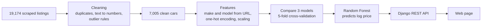

# Qeemat: Used Car Price Estimator for Pakistan

[](https://github.com/devshayanai-code/pak-wheels-price-predictor/actions/workflows/tests.yml)

**Live demo:** https://pakwheels-price-api.onrender.com *(free hosting: the first visit can take up to a minute to wake the server)*

Qeemat ("price" in Urdu) estimates the fair market value of a used car in Pakistan. Enter the make, model, year, mileage, engine, fuel, transmission and city, and a machine learning model built from 7,005 cleaned PakWheels.com used-car listings (5,604 to train, 1,401 held back to test) returns:

- an **estimated price** in lakh or crore,
- a **likely price range** based on the model's measured error,
- a **deal verdict** if you enter the seller's asking price,
- **real listings of the same car** to compare against.

## Results

Three regression models were compared with 5-fold cross-validation on the training set; the winner was then scored once on a held-out test set of cars it never saw.

| Model | CV average % error | CV average error (PKR) | CV R² |
| --- | --- | --- | --- |
| **Random Forest** (chosen) | **15.95%** | 914,793 | 0.845 |
| Gradient Boosting | 16.19% | 934,644 | 0.859 |
| Ridge regression (baseline) | 17.85% | 1,100,280 | 0.792 |

**Held-out test set:** 15.3% average error (MAPE), PKR 821,847 mean absolute error, R² 0.715. R² is lower on the test set because of one car: a PKR 20 crore Range Rover Vogue accounts for 86% of the squared error, and R² is 0.941 without it. That sensitivity to a single expensive car is why average percentage error is the headline metric.

## How it works



1. **Cleaning** (`src/data_cleaning.py`): one row per listing (the raw data repeated each car under several categories), prices like `PKR 3,650,000` and mileages like `138,000 km` converted to numbers, make and model extracted from each listing's URL, rare cities grouped as "Other", and typos or impossible values removed with documented rules (price under PKR 1 lakh, mileage over 500,000 km, engines over 7,000 cc, cars older than 1980).
2. **Exploration** (`src/eda.py`): price is heavily right-skewed, so the model learns `log(price)` and answers in rupees. Year (+0.55), engine size (+0.45) and mileage (−0.26) correlate with log price as expected. Charts are in `reports/figures/`.
3. **Training** (`src/train.py`): one scikit-learn pipeline holds the preprocessing and the model, so the API can never skip a step. Unseen car models at prediction time are handled instead of crashing.
4. **Serving** (`api/`): Django REST Framework validates every input (case-insensitive makes, the model must belong to the make, engine size required for non-electric cars), loads the model once, and returns the estimate with its range and comparable listings.

## Tech stack

Python 3.12 · pandas · NumPy · scikit-learn · Django 5.2 · Django REST Framework · pytest · GitHub Actions · Render

## API

| Endpoint | Method | Returns |
| --- | --- | --- |
| `/api/health/` | GET | Service status and model name |
| `/api/options/` | GET | Valid makes with their models, fuels, transmissions, cities, year range |
| `/api/predict/` | POST | Estimate, likely range, average error, similar listings |

```bash
curl -X POST https://pakwheels-price-api.onrender.com/api/predict/ \
  -H "Content-Type: application/json" \
  -d '{"make":"Toyota","model":"Corolla","year":2016,"mileage":95000,"engine_cc":1300,"fuel":"Petrol","transmission":"Manual","city":"Karachi"}'
```

```json
{
  "predicted_price": 3460000,
  "price_range": {"low": 2930000, "high": 3990000},
  "average_error_percent": 15.3,
  "similar_listings": [
    {"year": 2016, "mileage": 95000, "city": "Karachi", "price": 3050000},
    {"year": 2016, "mileage": 104000, "city": "Islamabad", "price": 4125000},
    {"year": 2016, "mileage": 109478, "city": "Lahore", "price": 4190000}
  ]
}
```

Predictions are limited to 60 per minute per visitor.

## Project structure

```
src/             data cleaning, EDA and training code
api/             Django project: REST API + the web page
tests/           15 pytest tests (cleaning steps and API)
data/raw/        original dataset (never edited)
data/processed/  cleaned dataset
reports/         charts and model scores (metrics.json)
models/          trained model (rebuilt, not stored in git)
render.yaml      Render deployment blueprint
```

## Run it locally

```bash
python -m venv venv
venv\Scripts\activate            # Windows (macOS/Linux: source venv/bin/activate)
pip install -r requirements-dev.txt
python -m src.data_cleaning      # raw CSV -> data/processed/
python -m src.train              # trains, compares and saves the model
python -m pytest -q              # 15 tests
cd api && python manage.py runserver
```

Then open http://127.0.0.1:8000/.

## Deployment

Render builds the app from `render.yaml`: it installs the requirements, cleans the data and trains the model during the build, then serves it with gunicorn. The secret key is generated by Render and never stored in the code. GitHub Actions runs the same build and all tests on every push.

## Limitations

- Prices are asking prices from listings, not final sale prices.
- The data is a snapshot; prices drift with inflation and the rupee, so the model needs retraining on fresh data to stay current.
- Condition, colour, accident history and trim level are not in the data, which explains part of the error.

## Data and credits

- Data: **PakWheels Used Car Listings**, a scraped dataset of used-car ads from [PakWheels.com](https://www.pakwheels.com), Pakistan's largest car marketplace. 19,174 rows (7,314 unique ads, because each ad appeared under several site categories), model years 1960 to 2025, 193 cities. Columns: category, title, price, city, year, mileage, fuel, engine, transmission, url (every url is the original PakWheels listing). The page it was downloaded from and its licence were not recorded; it is included here for educational, non-commercial use, and listings belong to their original posters.
- Photos on the website: [Unsplash](https://unsplash.com).

## Author

**Shayan Ali Shah**, computer science student at Virtual University of Pakistan, building towards full-stack AI engineering. GitHub: [@devshayanai-code](https://github.com/devshayanai-code)
